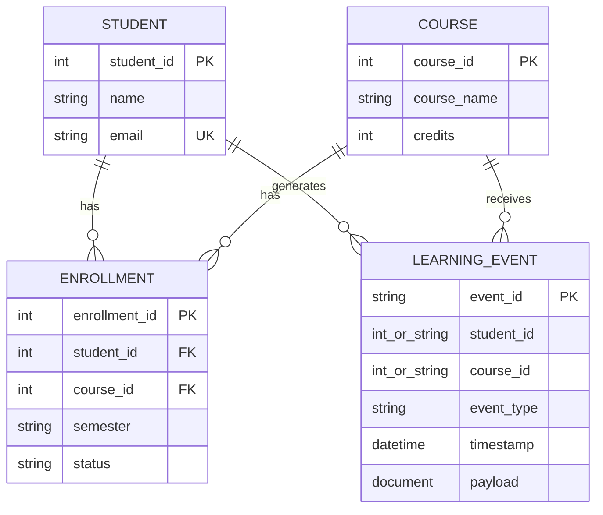

# Polyglot Learning Lab

A DBMS course project implementing **Polyglot Database: SQL + NoSQL Data Integration**.
MySQL holds official academic records. MongoDB holds flexible learning events.
Python validates both sources, normalizes identifiers, and combines their results.
The Streamlit interface provides reports, data-quality checks, source inspection and benchmarking.

## Quick start on Windows

Install Python 3.11 or later. Open a terminal in this folder:

```powershell
python -m venv .venv
.\.venv\Scripts\python.exe -m pip install -r requirements.txt
.\.venv\Scripts\python.exe -m streamlit run app.py
```

The dashboard opens at http://localhost:8501. Choose **Demo** to run immediately.
On subsequent runs you can also use `powershell -ExecutionPolicy Bypass -File .\run_demo.ps1`.
All data is synthetic and generated with a fixed random seed. There are 120 students,
3 courses, 360 enrollments, and 5,994 learning events. Students divisible by 13 have no
events. Students divisible by 17 have withdrawn enrollments.

`requirements-lock.txt` records the exact package versions used during verification on Python 3.12.
Use it in place of `requirements.txt` to reproduce that environment.

## Reliable startup on Windows

After the initial Python and Docker installation, open PowerShell in this folder and run:

```powershell
powershell -ExecutionPolicy Bypass -File .\project.ps1
```

This checks Docker Desktop (and starts it if needed), starts and waits for both database containers,
checks the academic tables and event collection, and launches a background dashboard with saved logs.
Open http://127.0.0.1:8501 and choose **MySQL + MongoDB**. An already healthy dashboard is reused.
Closing the launching PowerShell window does not intentionally stop this background dashboard.
This does not set up automatic startup after a Windows restart; run the command again then.

For a new, dedicated CP database with no sample data, add `-Seed`. This explicitly upserts the
fixed sample IDs; omit it for normal starts.

Check readiness:

```powershell
powershell -ExecutionPolicy Bypass -File .\project.ps1 -Action Status
```

Stop only the dashboard created by this launcher:

```powershell
powershell -ExecutionPolicy Bypass -File .\project.ps1 -Action Stop
```

Then run the normal startup command to restart it. The stop command verifies the saved process
identity before terminating that process tree. It leaves database containers and records intact.
A dashboard started manually is not stopped by this helper: use Ctrl+C in its original terminal.
If an unresponsive process occupies port 8501, the launcher reports the conflict instead of
terminating an unknown process. Logs are in `.runtime/dashboard.out.log` and
`.runtime/dashboard.err.log`; the private process record is `.runtime/app-state.json`.
Readiness checks do not print credentials or connection strings.

## Run with real MySQL and MongoDB

Install and start Docker Desktop, then run:

```powershell
Copy-Item .env.example .env
docker compose up -d --wait
.\.venv\Scripts\python.exe storage.py
.\.venv\Scripts\python.exe -m streamlit run app.py
```

Choose **MySQL + MongoDB** in the sidebar. MySQL uses host port **3307** and MongoDB
uses **27018** to reduce clashes with existing installations. Both ports bind to localhost.
If using databases installed separately, create the database/user first and update `.env`.
The seed command creates tables and MongoDB indexes. It upserts the fixed sample IDs,
so running it again does not duplicate sample records. It does not delete unrelated records.
Use a dedicated database because sample IDs may overwrite matching IDs.
Do not commit `.env`. The supplied passwords are only for this local classroom setup.

Stop containers while keeping data:

```powershell
docker compose stop
```

MySQL schema and credentials are initialized when its volume is first created. Changing
passwords in `.env` alone does not update users in an existing database volume.
If seeding is interrupted after the MySQL commit, rerun it to complete MongoDB upserts.
The seed is not a distributed transaction.

## Demo walkthrough

1. Open **Database explorer**. Show relational student, course and enrollment records,
   then event documents with different payloads.
2. Open **Learning dashboard**, choose DBMS and August 2026. Use the Student filter for an individual report. Explain that only active
   enrollments participate and students without matching events still appear.
3. Change the activity filter to quiz or video. Download the CSV report and JSON provenance.
4. Choose **Duplicate event** under Validation demonstration. Open **Data quality**.
   Show the issue and demonstrate that the integrated dashboard is blocked.
5. Repeat with **Orphan student**, **Missing field** and **Wrong type**, then restore clean data.
6. With live databases configured, open **Performance** and run the comparison.
   Discuss actual timings without promising a speedup. Demo mode cannot measure database optimization.

## Data model



Event relationships in this diagram are application references, enforced by Python validation.

| Source | Entity | Key and relationship |
|---|---|---|
| MySQL | students | student_id primary key, unique email |
| MySQL | courses | course_id primary key |
| MySQL | enrollments | enrollment_id primary key, student/course foreign keys |
| MongoDB | learning_events | unique event_id, student_id and course_id references |

A student has many enrollments. A course has many enrollments. Each event references one
student and one course. There is no database-enforced foreign key across MySQL and MongoDB.
Python explicitly checks these references and verifies enrollment exists.
The course reference on each event is needed to separate the same student's activity across courses.

The SQL unique enrollment key is `(student_id, course_id, semester)`. Queries include a student
once if they have an active enrollment for that course. Events are not assigned a semester:
date filters select their period. This prototype does not model historical enrollment dates.

Event common fields: `event_id`, `student_id`, `course_id`, `event_type`, UTC `timestamp`, `payload`.

| Event | Payload |
|---|---|
| quiz | score, max_score |
| video | seconds_watched |
| forum | post_id, word_count |

## Integrity and report definitions

Both query paths require full-snapshot validation. Checks include duplicate keys and emails,
enrollment references, required metadata, integer/string IDs, aware timestamps and numeric payload
ranges. Positive integers and ASCII decimal strings normalize to the same ID. Floats and booleans
are rejected. Extra payload fields are allowed to preserve document flexibility.

The query uses a left join from active enrolled students. An optional student filter applies to both
the MySQL student selection and the MongoDB aggregation. Course and activity filters apply to events.
Dates are inclusive in the UI and converted to `[start, next day after end)` in UTC.

- Event count: matching quiz, video and forum events.
- Quiz percentage: mean of per-attempt `score / max_score * 100`, not weighted by maximum score.
- Video minutes: sum of watch seconds / 60, including repeated views.
- Forum posts: number of forum events.
- No activity: zero matching events, not a prediction or risk classification.
- A missing quiz average means no attempts. It is not a score of zero.

## Benchmark methodology

Basic reads all three SQL tables and all events, filters in Python and combines results.
Optimized queries active students in MySQL and uses MongoDB `$match` and `$group` to return
per-student aggregates. The timestamp index supports the initial range filter. ID conversion
stages support mixed ID types, but prevent using a direct ID equality index for those stages.
This is a documented tradeoff between identifier compatibility and index efficiency.

Validate once before the comparison. Alternate query order, exclude one warm-up per path,
measure five runs, report median/min/max and the number of returned rows/documents.
Compare every result against the same validated baseline. Abort on any mismatch.
Do not interpret row counts as bytes, server scanned rows, or peak memory.
Timings include source queries, transfer and report assembly, but exclude shared validation
and the initial snapshot loading. Production end-to-end cost includes those excluded costs.
No fixed performance improvement is claimed. The current dataset is intentionally small.

Pause source writes during a demo or benchmark. MySQL and MongoDB do not share an atomic
snapshot. The application compares live output against its validated snapshot, but this cannot
guarantee consistency across concurrent updates that happen to produce identical aggregates.
Full-source validation also reads all events, so this implementation demonstrates query-stage
transfer savings rather than eliminating all source reads from the entire request.

## Tests

```powershell
.\.venv\Scripts\python.exe -m unittest discover -s tests -v
```

Tests check deterministic sample generation, reference validation, metric correctness,
date boundaries, zero-activity students, invalid IDs, fail-closed reports and benchmark equivalence.
Streamlit UI tests also exercise every page, activity/student filters, validation demonstrations,
and the demo benchmark. The ID normalizer also covers BSON Int64 identifiers returned by MongoDB
aggregation. Core tests and live integration checks passed against the seeded MySQL and MongoDB
databases. Live checks cover all three courses, all activity filters, individual students and
zero-activity students, plus benchmark result equivalence.

To run the optional read-only live checks after loading the sample data:

```powershell
$env:POLYGLOT_LIVE_TESTS = '1'
.\.venv\Scripts\python.exe -m unittest discover -s tests -p test_live.py -v
```

## Files

| File | Purpose |
|---|---|
| app.py | Streamlit user interface |
| core.py | Sample data, integrity checks and combination logic |
| storage.py | Live MySQL/MongoDB adapters and seed command |
| service.py | Report validation and benchmark execution |
| schema.sql | Relational constraints and indexes |
| compose.yaml | Local database containers and persistent volumes |
| project.ps1 | Windows startup, readiness, duplicate startup protection and owned-process stop |
| doctor.py | Read-only readiness checks with sanitized failure messages |
| tests/test_project.py | Automated correctness tests |

## Scope

This is a local educational prototype using synthetic data. It has no login, roles or write UI.
The full validation scan and MongoDB `$in` list suit a small CP dataset. Large-scale systems need
bounded batches, incremental validation, additional observability and a concurrency design.

Implementation references:
- [Streamlit documentation](https://docs.streamlit.io/)
- [MySQL Connector/Python](https://dev.mysql.com/doc/connector-python/en/)
- [PyMongo aggregation](https://www.mongodb.com/docs/languages/python/pymongo-driver/current/aggregation/)
